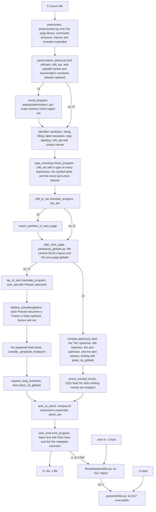
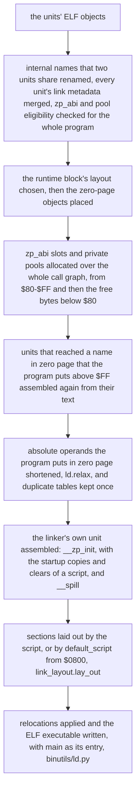

# Architecture

This document describes how c6502 turns a C file into 6502 code. It
covers the order of the stages, the four intermediate representations
(IRs) they pass along, the names the stages make up, and the
conventions the generated code and its runtime follow. Each section
can be read without the others, so a reader looking for one stage
can go straight to it.

The details of each module are in the `CLAUDE.md` of its directory,
and the larger modules' docstrings describe their own lowerings. The
optimizer has its own index, [optimizations/README.md](optimizations/README.md),
and the calling conventions have [calling_conventions.md](calling_conventions.md).

## The pipeline

`compile.py` runs every stage, and `--lex`, `--parse`, `--resolve`,
`--tac`, `-S`, and `-c` stop it at the stage they name. The labels
on the arrows mark the steps that only one of the two pipelines runs.

`--tac` prints the TAC straight after `c99_to_tac`, or after the TAC
optimizer with `-O`, and doesn't run `plan_zero_page`. The emitted
text goes through one more rewrite, `passes/y_peephole.py`, which
merges neighboring `LDY #n` setups. It works on lines of text, which
is why it isn't a box of its own.

| Stage | Module | Detail |
|---|---|---|
| Preprocessing | `preprocessor.py` | pcpp's Python API. `include/` is on the search path. Flags `compile.py` doesn't know are passed to it. In `#if`, `true` is 1 and `false` is 0, as in C23, and each `_Bool` gets a warning (`diagnostics.py`). |
| Parsing | `parser.py`, `c99.lark`, `lexer.py` | LALR, with the AST built as each rule reduces, so that `typedef` names are known while parsing. See "Parser" in [../CLAUDE.md](../CLAUDE.md). |
| Name resolution | `passes/identifier_resolution.py`, `string_lifting.py`, `label_resolution.py`, `loop_labeling.py` | [../passes/CLAUDE.md](../passes/CLAUDE.md), passes 2 to 5 |
| Type checking | `passes/type_checking.py` | Promotions, conversions, and the symbol table. [../passes/CLAUDE.md](../passes/CLAUDE.md), pass 6 |
| Translation to TAC | `c99_to_tac.py` | The module docstring maps each C construct to TAC. |
| Translation to asm | `tac_to_asm.py` | The module docstring gives each lowering and each helper's layout. |
| Pseudoregister replacement | `passes/replace_pseudoregisters.py` | [../passes/CLAUDE.md](../passes/CLAUDE.md), pass 9 |
| The optimizer | `compile.optimized_asm` and `passes/` | [optimizations/README.md](optimizations/README.md) |
| Lowering to asm2 | `passes/asm_to_asm2.py` | [../passes/CLAUDE.md](../passes/CLAUDE.md), pass 10 |
| Emit | `asm_emit.py` | The module docstring gives the text for each instruction. |
| Assembling | `binutils/assembler.py`, `binutils/elf.py` | [../binutils/CLAUDE.md](../binutils/CLAUDE.md) |
| Linking | `passes/linker.py`, `passes/link_layout.py`, `binutils/ld.py` | [linker_scripts.md](linker_scripts.md) and "Linking" below |

The simulator's harness, `sim/harness.py`, calls the same functions
(`translate_for_codegen`, `optimized_asm`, and
`_peephole_fixedpoint`), so that the tests run the code the command
line writes.

## The four IRs

Each IR is declared in an ASDL file, and `asdl.py` generates a module
of dataclasses from it. A sum type's base class is `Type_<name>`, and
each constructor keeps its ASDL name.

| IR | Declared in | Made by | What it holds |
|---|---|---|---|
| `c99_ast` | `c99.asdl` | the parser | Declarations, statements, and expressions in the source's shape. The type checker fills in each expression's `data_type`. |
| `tac_ast` | `tac.asdl` | `c99_to_tac` | Three-address code, a flat list of instructions per function, whose operands are constants and named variables. The width and signedness of each variable come from the symbol table. |
| `asm_ast` | `asm.asdl` | `tac_to_asm` | One instruction for each 6502 instruction, with four compound exceptions, on byte operands. |
| `asm2_ast` | `asm2.asdl` | `asm_to_asm2` | `asm_ast` with the compound instructions expanded, so every instruction is one 6502 instruction. |

### c99_ast

A program is a list of declarations, each a `VarDecl` or a
`FunctionDecl`, and a function definition is a `FunctionDecl` with a
body. Types are `Int()`, `UChar()`, `BitInt(width, is_signed)`,
`Pointer(...)`, `Array(...)`, `FunType(...)`, and so on, with
`Const(...)` and `Volatile(...)` wrapping a qualified type. `typedef` and `enum` never reach the AST,
since the parser puts the types and values in place of the names.

### tac_ast

Every expression is flattened into instructions that write a fresh
temporary, and control flow is `Label`, `Jump`, `JumpIfTrue`,
`JumpIfFalse`, and the fused jumps the optimizer makes (`JumpIfCmp`,
`JumpIfMasked`). `&&`, `||`, and `?:` become jumps here, so no
later IR has a node for them. Every function ends in a `Ret`, and a
`Ret` of zero is added to a body that doesn't end in one. The indexed loads and
stores (`IndexedLoad`, `IndirectIndexedStore`, and the others), which
later become `abs,X` and `(zp),Y` accesses, come from `c99_to_tac`
for some subscripts and from the optimizer's recognizers for the
rest. The optimizer adds `Phi` while a function is in SSA form.

An integer in the TAC is 1 to 8 bytes. C23's bit-precise types
(`_BitInt(N)`, bit_precise.py) take ceil(N/8) bytes, and `c99_to_tac`
restores their padding bits after each operation and then replaces
each one with the type of its storage: a standard integer type for 1,
2, 4, and 8 bytes, and `BitInt(24)`, `BitInt(40)`, `BitInt(48)`, or
`BitInt(56)` for the other sizes, whose constants are `ConstInt24` to
`ConstUInt56`. Every pass after it handles those as whole bytes.

### asm_ast

The 6502 is an 8-bit machine, so every operand is a byte, and
`tac_to_asm` lowers each multi-byte TAC instruction as one sequence
per byte, with the carry flag passed from each byte to the next. A
multi-byte variable is a run of `Pseudo(name, offset)` operands, one
for each byte. The operands are the following.

| Operand | Addressing | Made by |
|---|---|---|
| `Imm(v)` | `#v` | `tac_to_asm` |
| `Reg(A)`, `Reg(X)`, `Reg(Y)` | a register | `tac_to_asm`, and the register allocator's coloring |
| `Pseudo(name, k)` | byte `k` of a variable, not yet placed | `tac_to_asm` |
| `Stack(k)` | `LDY #k` then `(SSP),Y` | `tac_to_asm`, for the arguments of a soft-stack call |
| `Frame(k)` | `LDY #k` then `(FP),Y` | pseudoregister replacement, for parameters and locals in the frame |
| `Data(name, k)` | `name+k`, zero-page or absolute as the address falls | pseudoregister replacement for statics, `tac_to_asm` for zp_abi slots, and the coloring for private-pool bytes |
| `ZP(addr, k)` | a zero-page byte by its number | the coloring, in a function without a private pool |
| `Indirect(k)`, `IndirectY()` | `(DPTR),Y`, with Y loaded or already set | `tac_to_asm`, for loads and stores through a pointer |
| `IndirectZp(addr, k)`, `IndirectZpY(addr)` | `(addr),Y` through a pointer kept in zero page | the peepholes |
| `IndexedData(name, k, X or Y)` | `name+k,X` or `name+k,Y` | `tac_to_asm`, from the indexed TAC instructions |
| `ImmLabelLow(name, k)`, `ImmLabelHigh(name, k)` | `#<(name+k)`, `#>(name+k)` | the address of an object |

The four compound instructions are `FunctionPrologue`, `Ret` (the
epilogue and `RTS` of a function with a frame), `AllocateStack` (the
caller's `SSP -= N` before it pushes arguments), and `DecimalArith`
(a packed BCD add or subtract, which stays one instruction so that
no pass can put code between its `SED` and `CLD`). `Phi` appears only
while the asm optimizer has a function in SSA form. `Return` is a
bare `RTS`.

### asm2_ast

`asm_to_asm2` expands the compound instructions. A `DecimalArith`
becomes `SetDecimal`, a carry setup, an `LDA`, `ADC` or `SBC`, and
`STA` for each byte, and `ClearDecimal`. `PushStatus` and
`PullStatus` keep the carry flag across a frame teardown. `Comment`
and `Blank` lay out the prologue and epilogue in the text.
`LoadAddress` stays one instruction.

## Names the stages make up

The names a stage makes up contain a character a C identifier can't
have, usually `@`, so they never collide with the program's names.

| Name | Example | Made by |
|---|---|---|
| `@N.name` | `@0.total` | identifier resolution, for every variable and parameter without linkage, including a block-scope `static` |
| `%N` | `%4` | `c99_to_tac`, for each temporary, entered in the symbol table with its type |
| `str@N` | `str@0` | string lifting, for a string literal made into a static array |
| `.fn@label` | `.sum@done` | label resolution, for a `goto` label |
| `.loop@N`, `.switch@N`, `.case@N`, `.default@N` | `.loop@0_start` | loop labeling, with `_start`, `_continue`, and `_break` added by `c99_to_tac` |
| `name.k` | `@0.total.2` | the TAC optimizer's SSA versions, some of which are left after SSA destruction |
| `name.bB.vN` | `@0.total.2.b0.v1` | the asm optimizer's SSA version `N` of byte `B` |
| `__zpabi_fn__param` | `__zpabi_lt__b_0` | `passes/abi_selection.py`, a zp_abi parameter's slot, with `_k` for byte `k` of a wider one |
| `__local_fn__var` | `__local_sum__total` | `passes/zp_slot_naming.py`, a byte of a function's private pool, `__local_fn__N` for a temporary |
| `fn@ret`, `fn@tailN`, `fn@runN` | `sum@run0` | `return_in_zero_page.py`, `shared_tails.py`, and `outline_runs.py` |

Labels that start with `.` are local to the function's `SUBROUTINE`
in dasm, so two functions can use the same one.

## Lowering notes

These are the lowerings that a reader of the output most often has
to recognize. `tac_to_asm.py`'s docstring has the rest.

| C | 6502 code |
|---|---|
| a multi-byte `+` or `-` | `CLC` or `SEC` once, then `LDA; ADC; STA` (or `SBC`) for each byte, low byte first. `LDA` leaves C alone, so the carry passes from byte to byte. |
| `==`, `!=` | `CMP` of each byte, the high byte first, branching out at the first difference |
| `<`, `<=`, `>`, `>=` on signed values | a subtract of each byte, then `BVC` over `EOR #$80` to correct N after an overflow, then `BMI` or `BPL`. `>` and `<=` swap the operands. |
| the same on unsigned values and pointers | a subtract of each byte, then the carry flag |
| `*p`, `p->m` | the pointer copied to `DPTR`, then `LDY #k; LDA (DPTR),Y`. With `-O`, a pointer kept in zero page is used in place, as `(ptr),Y`. |
| `a[i]` on a static array with a byte index | `LDA a,X` (with `-O`) |
| `*`, `/`, `%`, a shift by a variable | the operands stored in `HARGS`, `JSR` to a helper, the result loaded from `HARGS` (see "The helpers' exchange block") |
| a shift by a constant | inline `ASL` and `ROL` (or `LSR`, `ROR`) chains when that's at most 8 shift instructions, by `passes/shift_cost.py`'s rule, otherwise a helper |
| a call through a pointer | the pointer copied to `DPTR`, then `JSR icall`, and `icall` is `JMP (DPTR)`. The callee's arguments go on the soft stack. |
| a static object | `Data`, with absolute or zero-page addressing, and `DC.B`, `DC.W`, `DC.L`, or `DS.B` for its storage |
| `+`, `-`, `*`, `<<`, unary `-`, or a conversion on a `_BitInt(N)` whose N isn't a multiple of 8 | the operation at the storage width, then an `AND` with the mask of the N bits, and for a signed type an `EOR` and an `SBC` of the sign bit, which copy bit N-1 into the padding. Below the top byte the mask is `$FF` and the sign bit's bytes are 0, and `-O` drops most of those bytes' instructions. |
| `*`, `/`, `%`, or a shift by a variable of a 3-, 5-, 6-, or 7-byte integer | the helper of the next of 4 and 8 bytes, each operand extended in `HARGS` (zero-filled for `*` and `<<`, by its signedness otherwise), and the low bytes of the result loaded back |
| a `<stdbit.h>` call, such as `stdc_leading_zeros(x)` | a loop between `.stdbit_body@N` and `.stdbit_test@N` that shifts a copy of `x` with `LSR` / `ROR` (or `ASL` / `ROL`) until it's zero, and counts the passes with `INC` or `DEC` of a byte (see docs/stdbit.md). A constant argument folds to its result. |

## Runtime conventions

### Zero page

| Bytes | Use |
|---|---|
| `$00`-`$01` | `SSP`, the soft stack pointer |
| `$02`-`$03` | `FP`, the frame pointer |
| `$04`-`$23` | `HARGS`, the helpers' exchange block, 32 bytes |
| `$24`-`$25` | `DPTR`, the pointer scratch for `(DPTR),Y` |
| `$26`-`$7F` | globals marked `[[c6502::zeropage]]`, the globals `-O` promotes, and the slots that don't fit above `$80` |
| `$80`-`$BF` | the register allocator's caller-saved half, and the window zp_abi parameter slots come from |
| `$C0`-`$FF` | the register allocator's callee-saved half |

That's the classic layout, in `passes/runtime_layout.py`. When a
fixed zero-page object (`[[c6502::address(addr)]]` or
`zeropage(addr)` below `$100`) is in `$00`-`$25`, `choose_layout`
sizes `HARGS` to the bytes the program uses and moves the four
names to the lowest free bytes below `$80`. The output binds each name with
an `EQU` line, so the code never depends on the numbers. When every
function in a unit has a private pool, and always when linking, the
slots and pools come from all of `$80`-`$FF`, since no function then
keeps a value in the callee-saved half across a call. A slot that
fits nowhere in zero page goes at `$0200` up, or in a `__spill`
block in `.bss` when linking with a script.

`SSP`, `FP`, `HARGS`, and `DPTR` belong to the runtime, and the
startup code sets `SSP` before calling `__zp_init` and `main`. The
simulator's boot stub (`sim/runtime.py`, `build_boot_stub`) is an
example.

### The soft stack and zp_abi

[calling_conventions.md](calling_conventions.md) traces a call
through each convention, with the frame's layout, the prologue, and
the epilogue. The selection rules and the allocation of zp_abi slots
and private pools are under "Call-graph-disjoint ZP allocation" in
[../passes/CLAUDE.md](../passes/CLAUDE.md). The original design is
[leaf_zp_abi.md](leaf_zp_abi.md).

### Return values

A 1-byte result comes back in A, and a 2-byte one in A (low) and X
(high). A 4-byte result comes back in `HARGS+8`-`HARGS+11`, and an
8-byte one in `HARGS+16`-`HARGS+23`, which are the slots the
floating-point helpers write their results to, so `return a + b;`
compiles with no copy of the result. A bit-precise type of 3 bytes
comes back from `HARGS+8` up, and one of 5, 6, or 7 bytes from
`HARGS+16` up. A struct comes back through a hidden pointer to the
caller's storage, passed as the first argument. A
`return_bool_in_carry` function returns its `bool` in C.

### The helpers' exchange block

A caller stores a helper's inputs at the bottom of `HARGS`, calls it,
and loads the result from the offset below. A helper leaves its
inputs as they were and may use the rest of `HARGS` as scratch.
Compiled code keeps no value in A, X, Y, `DPTR`, or `HARGS` across a
call, so a helper may overwrite all of them, and a result in `HARGS`
is read right after the call. `w` is the operand's width in bytes, 1, 2, 4, or 8, and the
helper's suffix is `8w` bits, as in `mul16`. An operand of 3, 5, 6,
or 7 bytes goes to the helper of the next of 4 and 8 bytes, extended
to that width (`tac_to_asm._odd_width_helper_op`).

| Helpers | Inputs | Output |
|---|---|---|
| `mul8` to `mul64` | `a` at `+0`, `b` at `+w` | the low `w` bytes of `a * b` at `+2w` |
| `udivmod8` to `udivmod64`, `sdivmod8` to `sdivmod64` | the dividend at `+0`, the divisor at `+w` | the quotient at `+2w`, the remainder at `+3w`. The signed ones round toward zero. |
| `asl8` to `asl64`, `lsr8` to `lsr64`, `asr8` to `asr64` | the value at `+0`, a 1-byte count at `+w` | the result at `+w+1` |
| `fadd`, `fsub`, `fmul`, `fdiv` | `a` at `+0`, `b` at `+4` | the result at `+8` |
| `dadd`, `dsub`, `dmul`, `ddiv` | `a` at `+0`, `b` at `+8` | the result at `+16` |
| `flt`, `fle`, `dlt`, `dle` | as the arithmetic helpers | 1 or 0 in one byte at `+8` or `+16` |
| `i2f`, `u2f`, `l2f`, `ul2f`, `ll2f`, `ull2f` and the `2d` forms | a 2-, 4-, or 8-byte integer at `+0` | the `float` or `double` right after it |
| `f2i`, `f2u`, `f2l`, `f2ul`, `f2ll`, `f2ull` and the `d2` forms | a `float` or `double` at `+0` | the integer right after it, truncated toward zero |
| `f2d`, `d2f` | the value at `+0` | the result at `+4` or `+8` |

`icall`, the trampoline for calls through a pointer, is
`JMP (DPTR)`.

The layouts above are the ones `sim/runtime.py`'s Python hooks read.
`passes/runtime_layout.py` records how many bytes of `HARGS` each
6502 helper in `sim/runtime_helpers.py` touches, and a helper written
outside the repository has to stay within those footprints, because
`choose_layout` sizes a moved `HARGS` by them.

## Output format

`asm_emit` writes dasm's syntax. Each function is its name as a label
and a `SUBROUTINE` line, then its instructions, with labels in column
1, opcodes in column 4, and operands in column 10. Before the code
come the `EQU` lines that bind the runtime's names and the slot
symbols, and, with `-O` or `-c`, the link metadata block between
`; @zp-link-meta-begin` and `; @zp-link-meta-end`. The assembler keeps
that block in each object's `.c6502.link` section, and the linker
allocates zero page from it.

## Linking

Each object holds one section for each function and object, its
symbols, its relocations, the link metadata, and the assembly text it
came from ([../binutils/CLAUDE.md](../binutils/CLAUDE.md)). The
linker treats every unit's zero-page slots as unplaced and places
them again for the whole program, in this order.

`sim/linked.py` runs the executable in the simulator, with the
helpers' addresses given by `sim.linked.defsym_args`.
