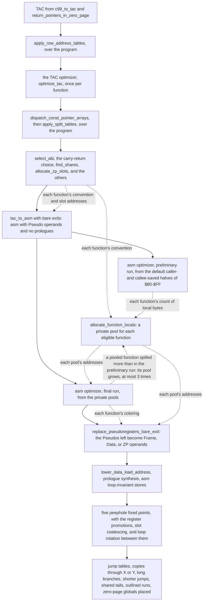
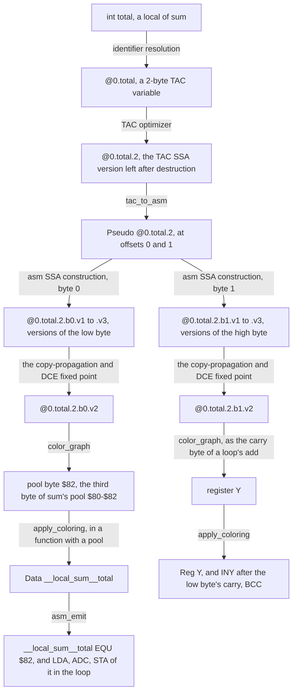
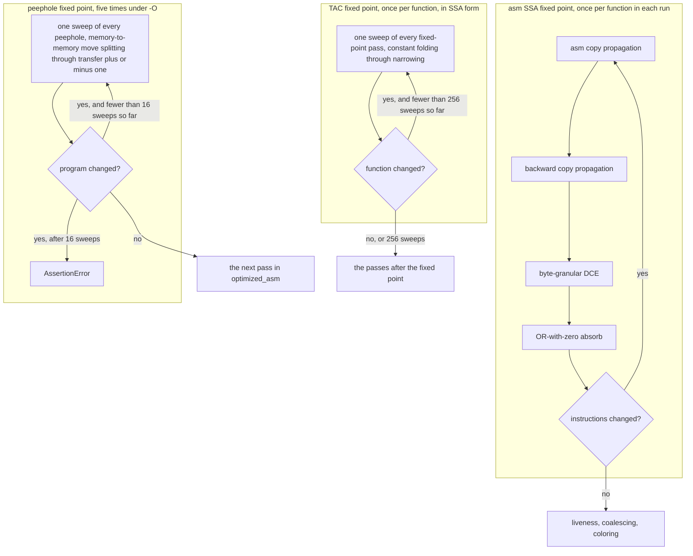

# Optimizations

Each file in this directory describes one optimization that c6502
performs. A file says what the optimization does and why it's cheaper
on the 6502, shows a small example before and after, and gives the
conditions under which it applies and the cases it leaves alone. The
next section describes how the optimizer as a whole is put together.

Most listings were captured from a compile by wrapping the one pass
the file describes and printing its input and output. The rest
compare two complete compiles, or come from the pass's unit test, and
their files say so. A listing from one of Zork's routines may have been
captured from an example that `examples/zork` grew out of
(`examples/zork/print_zstring`, `examples/zork/instr_save`, or a
single-routine `examples/zork_<routine>.c`), which were removed on 16
Nov 2026. The file names the interpreter's copy of the routine, which
can compile a little differently. Lines the pass doesn't touch are sometimes left
out, and `...` marks the place. Asm after pseudoregister replacement is shown as the
6502 text the compiler emits. TAC, and asm from before pseudoregister
replacement, are shown one IR instruction per line, as the
instruction's constructor with its fields in order. Operators are
written as their C symbols, except that unary minus is `neg`. A
constant carries a suffix for its type, which is `uc` for `unsigned
char`, `sc` for `signed char`, `c` for `char`, nothing for `int`, `u`
for `unsigned int`, `L` and `UL` for `long` and `unsigned long`, `LL`
and `ULL` for the `long long` types, and `f` and `d` for `float` and
`double`. A name such as `%3.1` is a
compiler temporary, and a name such as `@0.i.2` is the SSA version of
a user variable.

## How `-O` is organized

Without `-O`, every variable and temporary lives in the function's
soft-stack frame, and each read of one is `LDY #off; LDA (FP),Y`,
4 bytes and 7 cycles. `-O` exists mostly to put those values in
zero page, where a read is `LDA zp`, 2 bytes and 3 cycles, or in X
and Y, and to clean up the code around them. It works at two levels.
The TAC optimizer rewrites whole values, such as an `int` or a
pointer, where arithmetic and control flow are still easy to
recognize. The asm optimizer then works on single bytes, after
`tac_to_asm` has split every value into bytes, so the two bytes of
an `int` can end up in different places, or one of them can be
dropped. The peepholes then rewrite short runs of 6502 instructions.

Both optimizers put a function in *SSA form* (static single
assignment) first. Every variable is renamed at each assignment, so
that each name is written exactly once, and where two paths with
different versions of a variable meet, a `Phi` picks the version of
the path taken. With one definition per name, a pass can replace a
read by what was written without first checking which assignment
reaches it. SSA destruction turns each `Phi` back into a copy at the
end of each path into the join.

### The stages

The steps of each stage, with each one's document, are in "Pipeline
order" below. What the list can't show is which steps feed which.
The asm optimizer runs twice over the same input, because the size
of each function's private pool of zero-page bytes has to be known
before the final run's allocation, and the only measure of it is a
run of the allocator.



A solid arrow passes the program to the next step. A dashed arrow is
other data that a later step reads. The preliminary run's output
program goes nowhere, and only its counts are kept. Both asm
optimizer runs and pseudoregister replacement also read the
conventions from ABI selection, and those arrows are left out.

### One value's way to zero page

This is `total` from the following function, followed through the
stages with the names it has in each. It's the `int` version of the
example in the root README, and the low and high bytes of `total`
end up in different places.

```c
#include <stdint.h>

uint8_t table[16];

int sum(void) {
    int total = 0;
    for (int i = 0; i < 16; i++)
        total += table[i];
    return total;
}
```



The pool's bytes are named after the variables they hold, so that
the linker can move them. A function without a private pool gets
numbered `ZP` operands from the coloring instead. The low byte of
`i` went to X and its high byte to `__local_sum__i_1`, `$81`, by the
same steps. A value that the allocator can't place, and one whose
address is taken, stays a `Pseudo` until pseudoregister replacement,
which puts it in the soft-stack frame, or an address-taken local of
a function with a pool in a free byte of the pool.

### How the fixed points repeat

Three groups of passes repeat until a sweep changes nothing, because
each pass can open up work for the others. A constant fold can make
a branch's condition constant, and unreachable-code elimination then
drops the dead arm and the `Phi` arguments that came from it. That
can leave a `Phi` with one source, which constant folding turns into
a copy on the next sweep and copy propagation then forwards.



The two limits guard against passes that undo each other's changes.
Only the peephole loop treats reaching its limit as a compiler bug.
The unoptimized pipeline runs the peephole fixed point once.

## Alphabetical list

- [A byte divided by a constant](byte_divide.md). Lowers an unsigned byte's `/` or `%` by a constant as a loop of subtractions, with one loop for a divide and a remainder of the same operands, and one helper call for such a pair of any other width.
- [A call that doesn't return](noreturn_call.md). Ends the path at a call to a `[[noreturn]]` function, so nothing after it has to survive the call.
- [A divide and a remainder computed together](divmod_hoist.md). Computes a `/` and a `%` of the same operands at one place when a store, a call, or a branch comes between them, so they share one loop or helper call.
- [A global read after it's stored](read_stored_global.md). Makes an instruction read a global just stored from a temporary, as `*++P` does, so the temporary folds away.
- [A loop counted down to 0](count_down.md). Makes a byte loop counter that only its own test and step read count the passes left, so the test is `DEC i; BNE`.
- [A parameter's copy in the parameter's slot](slot_coalescing.md). Renames a zero-page local that copies a parameter to the parameter's own slot, or that's copied into a callee's slot for the call, when they're never live with different values.
- [A product of two bytes](byte_product.md). Lowers a 16-bit product of two values from 0 to 255 as an 8-by-8 shift-and-add loop where it called `mul16`.
- [A pointer returned in zero page](return_in_zero_page.md). Makes a `static` function returning a pointer leave it in a zero-page pointer of its own, which its callers read through.
- [A step moved onto its edge](step_on_edge.md). Puts `t = i - 1`, whose result reaches `i` only by a copy on one edge out of the block, in place of that copy, so `while (i-- != first)` steps with `DEC i`.
- [Address of a zero-page local](lower_data_load_address.md). Splits a fixed-address LoadAddress into two immediate stores so peepholes can fold them.
- [Address-taken locals in zero page](address_taken_zp.md). Puts address-taken locals in free private-pool bytes instead of the frame.
- [AND jump fold](and_zero_jump_fold.md). Turns `if (byte & mask)` into a one-byte `JumpIfMasked` test with no temporaries.
- [Asm copy propagation](asm_copy_propagation.md). Replaces reads of a byte copied by a direct Mov with its source.
- [Asm dead-store elimination](asm_dead_store.md). Drops stores to memory that no reachable instruction reads before overwrite or return.
- [Asm loop-invariant store hoisting](asm_licm.md). Moves loop-invariant constant and copy stores in front of the loop.
- [Backward copy propagation](backward_copy_propagation.md). Makes a single-use temporary's definition store straight to the copy's destination.
- [Branch inversion](branch_invert.md). Turns a branch over a JMP into one branch on the opposite condition.
- [Branch on INC or DEC flags](dec_inc_branch_fold.md). Deletes `LDA M` between `INC`/`DEC M` and a branch on N or Z.
- [Branch threading on a known flag](branch_thread.md). Points a branch at a branch on the same flag straight where that one goes.
- [Branch threading on known values](branch_value_thread.md). Points a branch past the loads, compares, and branches at its target that its path has already decided.
- [Branch through jump](branch_through_jump.md). Points a branch straight past a label that holds only a JMP.
- [Branch to next label](branch_to_next_drop.md). Deletes a branch or JMP whose target is the label right after it.
- [Branching directly on `&&` and `||`](short_circuit_jump_fold.md). Removes the 0-or-1 value of `&&` and `||` and branches straight to the target.
- [Byte-by-byte three-way compare](three_way_compare.md). Splits `a < b` and `a == b` on the same 2-byte values into a compare of the high bytes and then the low ones.
- [Byte-granular dead-code elimination](byte_dce.md). Drops each Mov or Phi that writes a temporary byte nothing reads.
- [Byte-granular register allocation](regalloc.md). Puts each SSA byte value in a zero-page byte, X, or Y.
- [Carry already known](carry_known.md). Drops a SEC or CLC where C already has that value, or moves it in front of a loop whose back edges have it.
- [Carry INC](carry_inc.md). Turns in-place `ADC #0` carry bytes into BCC/INC chains and `SBC #0` into BCS/DEC.
- [Carry set again by a shift](carry_recompute.md). Deletes a load and shift that only set C to the value it already holds.
- [Carry-flag return peepholes](carry_return.md). Turns carry-flag returns into SEC/CLC and carry captures into BCC/BCS.
- [Carry-flag return without the annotation](carry_return_choice.md). Returns a static function's `bool` in C when every call branches on it or passes it on, and a zp_abi function's with external linkage always.
- [CMP and SBC fusion](cmp_sbc_fusion.md). Moves `SEC; SBC N` ahead of a branch so it replaces `CMP N`.
- [CMP for a discarded volatile read](volatile_void_read_cmp.md). Turns a discarded volatile pointer load into CMP, so A keeps its value.
- [Combining added constants](reassoc_const.md). Rewrites `(v + C2) + C1` as `v + (C1+C2)`, removing one add.
- [Common subexpression elimination](cse.md). Replaces a repeated pure computation or load with a Copy of the first.
- [Commuted ADC, AND, and ORA](adc_commute.md). Reads memory directly in ADC, AND, or ORA instead of reloading it after a spill, and reads a byte that X or Y holds with TXA or TYA.
- [Compare and subtract of the same operands](compare_subtract.md). Lowers `t = a - b` next to the `a < b` that guards it as one subtraction and a branch on its flags.
- [Comparison and jump fold](cmp_zero_jump_fold.md). Fuses a comparison and the jump on its result into one conditional jump.
- [Const-static fold](const_static_fold.md). Replaces reads of a static const scalar with immediates and drops its storage.
- [Constant AND and ORA fold](const_arith_fold.md). Folds `LDA #k` with `AND`/`ORA #k`, and `ADC #k1; CLC; ADC #k2` into one `ADC`, and deletes `ORA #0` and `AND #$FF`.
- [Constant folding](constant_folding.md). Evaluates operations, casts, jumps, and const-array reads whose operands are all constants.
- [Constant store order](constant_store_order.md). Groups a run of constant stores by value, so that each value is loaded once.
- [Copy folding](copy_folding.md). Makes the instruction that writes a single-use temporary write the Copy's destination directly.
- [Copy propagation](copy_propagation.md). Replaces each read of an SSA Copy's destination with its source.
- [Count-down counter in X or Y](counter_to_index_reg.md). Moves a counter used only by its DEC into X or Y.
- [CPX and CPY](cpx_cpy_peephole.md). Rewrites `TXA; CMP` or `TYA; CMP` as CPX or CPY when A is dead.
- [Cross jumping](cross_jump.md). Shares the instructions two blocks end with when both then jump to the same place.
- [Dead A arithmetic](dead_a_arith.md). Deletes instructions that write only A and flags when neither is read later.
- [Dead label drop](dead_label_drop.md). Deletes labels that no jump, branch, or Phi argument names.
- [Dead loop elimination](dead_loop_elimination.md). Deletes a side-effect-free loop whose values nothing reads afterward.
- [Dead static elimination](dead_static.md). Drops internal-linkage static objects that no instruction or initializer references.
- [Dead-store elimination](dead_store_elimination.md). Drops TAC instructions with unread SSA results, keeping calls but dropping their results.
- [DEC](dec_peephole.md). Rewrites an in-place 1-byte subtract of 1 as DEC, DEX, or DEY.
- [Default zp_abi calling convention](zp_abi.md). Passes eligible functions' arguments in fixed zero-page bytes with no frame.
- [DEX and DEY for a register counter](dec_register_peephole.md). Turns `TYA; SEC; SBC #1; STA; LDY` on an X or Y counter into DEX or DEY.
- [Direct load into X or Y](direct_index_load.md). Fuses `LDA M; TAX` or `TAY` into LDX or LDY when A is dead.
- [Direct member access](direct_member_access.md). Turns a load or store through `&obj + k` into direct byte access.
- [Dispatch on a small pointer table](dispatch_pointer_array.md). Rewrites `arr[i][j]` on a small pointer table as a compare-and-branch on `i`.
- [Indexed access to a static array of structs](static_indexed_access.md). Turns `o[i].m` on a static array into `LDA o+m,X`, and `(&o + i) + m` into `(&o + m) + i`.
- [Indexed load from a fixed address](recognize_indexed_load.md). Turns a byte load through a constant address plus a byte index into `LDA C,X`.
- [Indexed store to a fixed address](recognize_indexed_store.md). Turns a byte store through a constant address plus a byte index into `STA C,X`.
- [Indirect-indexed access through a pointer](recognize_indirect_indexed.md). Turns a byte access through a pointer plus a byte index or constant into `(zp),Y`.
- [INY and CPY for an incremented table byte](index_inc_cmp_y.md). Does table-byte plus or minus one and its compare in Y instead of a temporary.
- [Join store](join_store.md). Stores a value each arm of a branch leaves in a slot straight into the memory the join copies it to.
- [Jump tables](jump_table.md). Dispatches a switch's chain of compares through a table of its cases' addresses.
- [Load after read-modify-write](redundant_load_after_rmw.md). Deletes an unused load right after INC, DEC, or a shift of the same byte.
- [Logical-not jump fold](lnot_jump_fold.md). Removes a `!` used only by a jump and flips the jump's sense.
- [Link-time address arithmetic](label_offset_fold.md). Turns an add of a label's address and a constant into one immediate, `#<(name+k)`.
- [Loop constant in A](loop_constant_a.md). Loads a loop's one constant into A in front of the loop, and drops the `TXA` or `TYA` that tested an index register.
- [Loop counter in X](loop_counter_to_x.md). Moves an index loop counter into X, moving other index loads to Y.
- [Loop test at the bottom](rotate_loop_test.md). Moves a loop's test to its bottom, and drops the first test when it's known to pass.
- [Loop unrolling](unroll.md). Replaces a counted for loop marked `[[c6502::unroll]]` with one body copy per iteration.
- [Loop-carried value in A](promote_loop_carried_to_a.md). Keeps an incremented register parameter in A across its loop.
- [Loop-invariant compare key in A](loop_invariant_a.md). Keeps a loop's compare key in A and swaps the compare operands.
- [Loop-invariant extends and truncates](licm.md). Moves loop-invariant extends and truncates to the loop's preheader.
- [Members of a static object computed in place](in_place_member_update.md). Computes a value stored into a static struct's member in the member's bytes, and turns `s.m++` into INC.
- [Memory constant propagation](mem_const_prop.md). Replaces reads of bytes known to hold a constant in a block with immediates.
- [Memory value propagation](memory_value_propagation.md). Rewrites reads of staged zero-page bytes, and `(DPTR),Y`, to their original source.
- [Memory-to-memory move splitting](split_mem_to_mem.md). Splits memory-to-memory moves into LDA and STA atoms that other peepholes rewrite, and X-to-Y moves into the two transfers through A.
- [Move coalescing](coalescing.md). Merges copy-joined values in the interference graph so both share one byte.
- [Moving a constant out of an offset](reassoc_offset.md). Rewrites `p + (x + k)` as `(p + x) + k` so subscripts share `p + x`.
- [Multi-byte INC](inc_peephole.md). Rewrites an in-place add of 1 to memory as an INC and BNE chain.
- [Narrowing a bitwise operation on a byte](narrow_byte_bitwise.md). Does a promoted byte's `&`, `|`, or `^` at one byte when the result's high bytes are zero, so a comparison of it narrows.
- [Narrowing arithmetic on values from 0 to 255](narrow_byte_range.md). Does a promoted byte's `/`, `%`, `>>`, and a `<<` that stays below 256 on one byte, and reads the operands of a 16-bit product of two such values as bytes, when the values are bounded by 255.
- [Narrowing widened arithmetic](narrow_widened_arith.md). Does promoted byte arithmetic at one byte when only the low byte is used.
- [Operands without a staging temporary](cmp_through_tmp_fold.md). Rewrites `LDA src; STA tmp; LDA other; CMP tmp` as `LDA other; CMP src`, and the same for `ADC`, `SBC`, `AND`, `ORA`, and `EOR`.
- [OR-with-zero absorb](or_zero_absorb.md). Rewrites `LDA #0; ORA x` as `LDA x` before move coalescing.
- [Outlined runs](outline_runs.md). Moves a run of instructions that several places in a unit repeat into a function of its own, which each place calls.
- [PHA and PLA removal](dead_pha_pla.md). Drops a PHA/PLA pair around instructions that leave A untouched.
- [Private local pools](zp_local_pools.md). Gives each eligible function body-local zero-page bytes that no coexisting function uses.
- [Prologue synthesis](prologue_synthesis.md). Adds a soft-stack prologue and epilogue only to functions that need a frame.
- [Reads of X's save slot](x_save_slot_load.md). Rewrites loads of X's spill byte as TXA or STX.
- [Redundant compare](redundant_compare.md). Deletes a compare reached only through the branches after an identical compare, and a compare with 0 whose flags are already set.
- [Redundant LDY setup](y_peephole.md). Drops `LDY #n`, or makes it INY or DEY, when Y's value is known.
- [Redundant load elimination](redundant_load.md). Drops loads into A, X, or Y when the register already holds the value, and stores into a byte that already holds it.
- [Redundant store elimination](redundant_store.md). Drops a repeated `LDA S; STA D` copy when D still holds S.
- [Rematerialization of staged values](asm_remat.md). Reloads a staged value from its source so the staging-slot store dies.
- [Round-trip load drop](round_trip_load.md). Deletes `LDA M` after `STA M` when the flags already reflect A.
- [Row-address tables](row_address_tables.md). Looks up the address of a row of a 2-D array, whose rows aren't a power of two bytes long, in a table of the rows' addresses.
- [Saves around a recursive call](recursion_saves.md). Pushes the values live across a marked recursive call so the function can have a private pool.
- [Second index in Y](dual_index_promotion.md). Loads a byte reloaded into X several times into Y once at entry.
- [Shorter jumps](short_jumps.md). Sends jumps and jump-table entries for a stub that jumps to another function there, drops the stub, and makes a JMP after a constant load a branch.
- [Shared function tails](shared_tails.md). Moves the instructions several functions end with alike into a function of their own, which each jumps to.
- [Shift in A](shift_in_a.md). Turns `STA t; ASL t; LDA t` into `ASL A; STA t`, for any run of shifts and rotates or a loop of one-bit shifts, and `LDA g; ASL; STA g` into `ASL g`.
- [Self-store drop](self_store_drop.md). Deletes the `STA M` of an adjacent `LDA M; STA M` pair.
- [Sign-bit test without AND](and_sign_bit_branch.md). Turns `LDA M; AND #$80; BEQ/BNE` into `LDA M; BPL/BMI`, and `AND #$01; BEQ/BNE` into `LSR; BCC/BCS`.
- [Shifting a bit in through the carry](rotate_in.md). Lowers `(x << 1) | b`, with `b` 0 or 1, as `LDA b; LSR` and a `ROL` of each byte, or just the `ROL`s when C already holds `b`.
- [Shifts by a loop](shift_loop.md). Lowers a 1- or 2-byte shift by a variable count, or by a constant too large for a fixed run of shifts, as a loop of one-bit shifts with the count in X.
- [Signed countdown loop rotation](loop_rotate.md). Moves the `i >= 0` test of a signed countdown for loop to the bottom.
- [Sinking an AND past a bit test](sink_and_past_branch.md). Moves a byte AND past a bit-7 test into both successor blocks.
- [Sinking increments](sink_increment.md). Moves `Y = X ± c` past X's last read so X and Y share a register.
- [Static const reads](static_const_fold.md). Replaces reads of static const scalars, including fixed-address const pointers, with their values.
- [Store X or Y directly](via_a_store_fold.md). Turns `TXA; STA M` into `STX M` (and TYA into STY) when A is dead.
- [Strength reduction](strength_reduction.md). Rewrites multiply, divide, and modulo by constants as shifts, masks, adds, or copies.
- [Subtract-and-test fusion](sub1_test_zero_peephole.md). Drops `LDA #0; CMP i` after `SBC #1` and branches on the inverted carry.
- [Tables split into low and high bytes](split_tables.md). Stores a table of 2-byte elements read by a byte index as its low bytes and then its high bytes, so the index needs no shift.
- [Tail call](tail_call.md). Turns `JSR f; RTS` into `JMP f` in frameless functions, and a jump to an RTS into the RTS.
- [Tail merge](tail_merge.md). Branches to one shared copy of a repeated return sequence.
- [Testing the low byte after an INC chain](inc_low_byte_test.md). Sends an INC chain's first BNE where a test of the incremented low byte would go.
- [Transfer plus or minus one](transfer_pm1_store.md). Turns `TXA; SEC; SBC #1; STA M` into `DEX; STX M`, and the +1 and Y forms.
- [Truncate of an extend](truncate_extend_fold.md). Rewrites a truncate of an extend to read the extend's source directly, and an extend of an extend as one extend.
- [TXA past a branch](transfer_past_branch.md). Moves TXA or TYA after a branch when only the fall-through reads A.
- [Unreachable code drop](unreachable_drop.md). Deletes unlabeled instructions after a jump or return that no path reaches.
- [Unreachable code elimination](unreachable_code_elimination.md). Removes unreachable TAC blocks, then the stale Phi arguments, jumps, and labels.
- [Values kept in a callee's parameter bytes](slot_sharing.md). Gives a forwarded parameter its callee's slot, and keeps a local there across calls.
- [Y known zero after a DEY loop](dec_branch_indirect_y_fold.md). Drops `LDY #$00` before `(DPTR),Y` after a `DEY; BNE` fall-through.
- [Zero-page promotion](zp_promotion.md). Moves the busiest scalar globals into the zero-page bytes left below `$80`.

## Pipeline order

`compile.py -S -O` applies the optimizations in the
order below. Steps that aren't optimizations are listed in plain text
without a link, so that each optimization's neighbors can be seen. A
group marked *fixed point* runs every member in order, then repeats
the whole group until a sweep leaves the code unchanged.

This list is copied from `compile.optimized_asm`,
`compile._peephole_fixedpoint`, `_DRIVER` in
`passes/optimization/optimizer.py`, and `_optimize_function` in
`passes/optimization_asm/optimizer.py`. It has to be checked against
them whenever a pass is added or moved.

1. Parse. Then, on the AST:
   1. [Loop unrolling](unroll.md)
   2. Identifier resolution, string lifting, label resolution, loop
      labeling, type checking, and translation to TAC.
   3. [A pointer returned in zero page](return_in_zero_page.md)
   4. [Zero-page promotion](zp_promotion.md)
   5. [Row-address tables](row_address_tables.md), over the whole
      program.
2. TAC optimizer, once per function:
   1. [Signed countdown loop rotation](loop_rotate.md)
   2. [A call that doesn't return](noreturn_call.md)
   3. SSA construction.
   4. [Static const reads](static_const_fold.md)
   5. *Fixed point*:
      1. [Constant folding](constant_folding.md)
      2. [Strength reduction](strength_reduction.md)
      3. The three jump folds, run as one rule set. They are the
         [comparison and jump fold](cmp_zero_jump_fold.md), with
         its narrowing of a comparison kept as a value, the
         [AND jump fold](and_zero_jump_fold.md), and the
         [logical-not jump fold](lnot_jump_fold.md).
      4. [Dead loop elimination](dead_loop_elimination.md)
      5. [Unreachable code elimination](unreachable_code_elimination.md)
      6. [Common subexpression elimination](cse.md)
      7. [Loop-invariant extends and truncates](licm.md)
      8. [Copy propagation](copy_propagation.md)
      9. [Dead-store elimination](dead_store_elimination.md)
      10. [A global read after it's stored](read_stored_global.md)
      11. [Copy folding](copy_folding.md)
      12. [Combining added constants](reassoc_const.md)
      13. [Moving a constant out of an offset](reassoc_offset.md)
      14. [Direct member access](direct_member_access.md)
      15. [Indexed store to a fixed address](recognize_indexed_store.md)
      16. [Indexed load from a fixed address](recognize_indexed_load.md)
      17. [Truncate of an extend](truncate_extend_fold.md), then an
          extend of an extend
      18. [Sinking increments](sink_increment.md)
      19. [Sinking an AND past a bit test](sink_and_past_branch.md)
      20. [Narrowing widened arithmetic](narrow_widened_arith.md)
      21. [Narrowing arithmetic on values from 0 to 255](narrow_byte_range.md)
      22. [Narrowing a bitwise operation on a byte](narrow_byte_bitwise.md)
   6. [Indexed access to a static array of structs](static_indexed_access.md)
   7. [Indirect-indexed access through a pointer](recognize_indirect_indexed.md)
   8. [Compare and subtract of the same operands](compare_subtract.md)
   9. [A divide and a remainder computed together](divmod_hoist.md)
   10. [A loop counted down to 0](count_down.md)
   11. SSA destruction.
   12. [Copy folding](copy_folding.md), once more.
   13. [A step moved onto its edge](step_on_edge.md)
   14. [Byte-by-byte three-way compare](three_way_compare.md)
   15. *Fixed point*: [branching directly on `&&` and
      `||`](short_circuit_jump_fold.md)
3. [Dispatch on a small pointer table](dispatch_pointer_array.md),
   then [tables split into low and high bytes](split_tables.md),
   each over the whole program.
4. [Default zp_abi calling convention](zp_abi.md): ABI selection,
   then the [carry-flag return without the
   annotation](carry_return_choice.md), then [values kept in a callee's parameter
   bytes](slot_sharing.md), then parameter slot allocation.
5. Translation to asm, with [saves around a recursive
   call](recursion_saves.md), [members of a static object computed in
   place](in_place_member_update.md), [shifting a bit in through
   the carry](rotate_in.md), [a byte divided by a
   constant](byte_divide.md), [shifts by a loop](shift_loop.md), and
   [a product of two bytes](byte_product.md).
6. Asm SSA optimizer, run once to measure each function's local
   bytes. Its output is discarded. The steps are the same as in step
   8.
7. [Private local pools](zp_local_pools.md), sized from step 6 plus
   the bytes of [address-taken locals in zero
   page](address_taken_zp.md).
8. Asm SSA optimizer:
   1. [Const-static fold](const_static_fold.md), over the whole
      program.
   2. Per function:
      1. [Subtract-and-test fusion](sub1_test_zero_peephole.md)
      2. SSA construction.
      3. *Fixed point*:
         1. [Asm copy propagation](asm_copy_propagation.md)
         2. [Backward copy propagation](backward_copy_propagation.md)
         3. [Byte-granular dead-code elimination](byte_dce.md)
         4. [OR-with-zero absorb](or_zero_absorb.md)
      4. Liveness and the interference graph.
      5. [Move coalescing](coalescing.md)
      6. [Byte-granular register allocation](regalloc.md), which
         also applies the coloring.
      7. SSA destruction.
   3. [Dead static elimination](dead_static.md), over the whole
      program.
9. Placement of [address-taken locals in zero
   page](address_taken_zp.md), then pseudoregister replacement.
10. [Address of a zero-page local](lower_data_load_address.md)
11. [Prologue synthesis](prologue_synthesis.md)
12. [Asm loop-invariant store hoisting](asm_licm.md)
13. Peephole fixed point, first run. See below for its members.
14. [Loop-carried value in A](promote_loop_carried_to_a.md)
15. [Loop counter in X](loop_counter_to_x.md)
16. [Count-down counter in X or Y](counter_to_index_reg.md)
17. [Reads of X's save slot](x_save_slot_load.md)
18. Peephole fixed point, second run.
19. [Second index in Y](dual_index_promotion.md)
20. Peephole fixed point, third run.
21. [Carry already known](carry_known.md)
22. [A parameter's copy in the parameter's slot](slot_coalescing.md)
23. [Loop-invariant compare key in A](loop_invariant_a.md)
24. [Loop test at the bottom](rotate_loop_test.md)
25. Peephole fixed point, fourth run, since the rotation leaves
    shapes such as `DEC i; LDA i; BNE` at a loop's new bottom.
26. [Count-down counter in X or Y](counter_to_index_reg.md), once
    more, for a counter whose test the rotation moved next to its
    `DEC`.
27. Peephole fixed point, fifth run.
28. [Carry already known](carry_known.md), once more.
29. [Jump tables](jump_table.md)
30. [Store X or Y directly](via_a_store_fold.md), for a byte copied
    through X or Y while A is busy.
31. Long-branch expansion.
32. [Shorter jumps](short_jumps.md)
33. [Shared function tails](shared_tails.md)
34. [Outlined runs](outline_runs.md)
35. Zero-page global placement, and lowering to `asm2_ast`.
36. Emit, followed by [redundant LDY setup](y_peephole.md) on the
    emitted text.

The peephole fixed point (`compile._peephole_fixedpoint`) runs these,
in order, as one *fixed point*. Its loop is capped at 16 sweeps, and
reaching the cap raises an error.

1. [Memory-to-memory move splitting](split_mem_to_mem.md)
2. [Multi-byte INC](inc_peephole.md)
3. [Testing the low byte after an INC chain](inc_low_byte_test.md)
4. [Carry INC](carry_inc.md)
5. [DEC](dec_peephole.md)
6. [Subtract-and-test fusion](sub1_test_zero_peephole.md)
7. [Direct load into X or Y](direct_index_load.md)
8. [PHA and PLA removal](dead_pha_pla.md)
9. [CPX and CPY](cpx_cpy_peephole.md)
10. [Memory value propagation](memory_value_propagation.md)
11. [Shift in A](shift_in_a.md)
12. [Load after read-modify-write](redundant_load_after_rmw.md)
13. [Redundant load elimination](redundant_load.md)
14. [Redundant store elimination](redundant_store.md)
15. [Constant store order](constant_store_order.md)
16. [Join store](join_store.md)
17. [Rematerialization of staged values](asm_remat.md)
18. [Asm dead-store elimination](asm_dead_store.md)
19. [Loop constant in A](loop_constant_a.md)
20. [Dead A arithmetic](dead_a_arith.md)
21. [Dead label drop](dead_label_drop.md)
22. [Unreachable code drop](unreachable_drop.md)
23. [Branch inversion](branch_invert.md)
24. [Branch to next label](branch_to_next_drop.md)
25. [Branch through jump](branch_through_jump.md)
26. [Branch threading on a known flag](branch_thread.md)
27. [Branch threading on known values](branch_value_thread.md)
28. [DEX and DEY for a register counter](dec_register_peephole.md)
29. [TXA past a branch](transfer_past_branch.md)
30. [INY and CPY for an incremented table byte](index_inc_cmp_y.md)
31. [CMP for a discarded volatile read](volatile_void_read_cmp.md)
32. [Y known zero after a DEY loop](dec_branch_indirect_y_fold.md)
33. [Memory constant propagation](mem_const_prop.md)
34. [Constant AND and ORA fold](const_arith_fold.md)
35. [Link-time address arithmetic](label_offset_fold.md)
36. [Carry set again by a shift](carry_recompute.md)
37. [Carry-flag return peepholes](carry_return.md), which are three
    passes run back to back.
38. [Round-trip load drop](round_trip_load.md)
39. [Sign-bit test without AND](and_sign_bit_branch.md)
40. [Self-store drop](self_store_drop.md)
41. [Redundant compare](redundant_compare.md)
42. [Operands without a staging temporary](cmp_through_tmp_fold.md)
43. [Commuted ADC, AND, and ORA](adc_commute.md)
44. [CMP and SBC fusion](cmp_sbc_fusion.md)
45. [Branch on INC or DEC flags](dec_inc_branch_fold.md)
46. [Tail call](tail_call.md)
47. [Tail merge](tail_merge.md)
48. [Cross jumping](cross_jump.md)
49. [Store X or Y directly](via_a_store_fold.md)
50. [Transfer plus or minus one](transfer_pm1_store.md)

### Without `-O`

`compile.py -S` without `-O` runs none of the TAC or
asm SSA optimizations. It translates to asm, replaces
pseudoregisters, and runs the peephole fixed point above once, with
every member. It then expands long branches, places zero-page
globals, emits, and runs [redundant LDY setup](y_peephole.md) on the
text. Many peepholes find nothing to rewrite there, because every
temporary lives on the soft stack. Each peephole's file says whether
it fires in the unoptimized pipeline.
